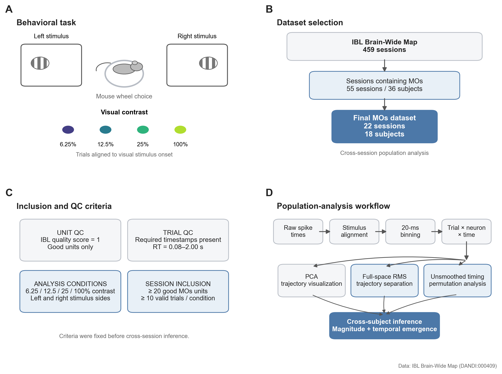
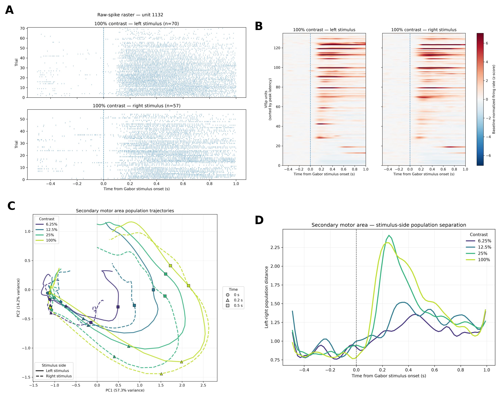
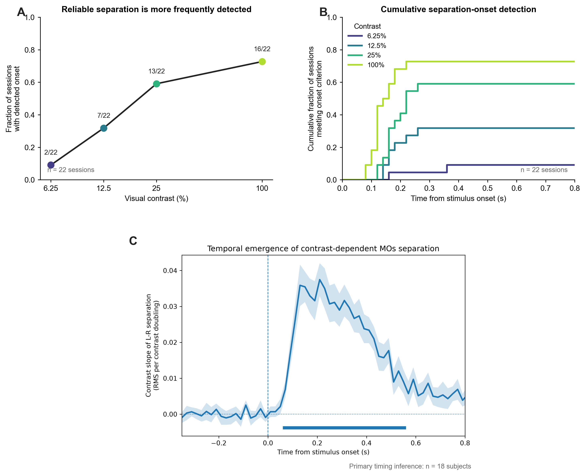

# Visual contrast scales the magnitude and temporal emergence of stimulus-side-associated population dynamics in mouse MOs

## Overview

How does visual evidence strength shape population-level neural dynamics in secondary motor cortex (MOs)?

Using publicly available electrophysiology data from the International Brain Laboratory (IBL), this project examines whether visual contrast modulates stimulus-side-associated population activity in MOs. Across subjects, stronger visual contrast was associated with larger population excursions, greater separation between left- and right-associated population states, and an earlier emergence of contrast-dependent separation.

The analysis progresses from session and unit quality control, through single-session population dynamics, to cross-subject statistical inference.

## Analysis framework



## Dataset and cohort selection

This project uses publicly available electrophysiology and behavioral data from the International Brain Laboratory (IBL) Brain-Wide Map dataset, distributed through DANDI dandiset **000409**.

The analysis began with **459 recording sessions from 139 subjects**. Sessions containing recordings from secondary motor cortex (MOs) were identified using the anatomical region labels provided in the dataset, yielding **55 MOs sessions from 36 subjects**.

To ensure sufficient neural and behavioral sampling for population-level analyses, sessions were required to contain:

- at least **20 high-quality MOs units** (`ibl_quality_score == 1.0`);
- at least **10 valid trials per stimulus-side × contrast condition**;
- valid behavioral timing information;
- reaction times between **0.08 and 2.0 s**.

Visible-stimulus trials were grouped by **stimulus side** (`gabor_stimulus_side`) rather than behavioral choice. The main analysis included four non-zero visual contrast levels:

**6.25%, 12.5%, 25%, and 100%.**

After quality-control and sampling criteria were applied, the final cross-session dataset contained **22 MOs sessions from 18 subjects**.

Importantly, repeated sessions from the same animal were averaged within subject before cross-subject statistical inference, so the primary inferential unit was the **subject**, not the recording session.
The session-screening workflow is documented in:

- [`01_session_inventory.ipynb`](notebooks/01_session_inventory.ipynb)
- [`02_global_session_region_inventory.ipynb`](notebooks/02_global_session_region_inventory.ipynb)
- [`03_select_candidate_sessions.ipynb`](notebooks/03_select_candidate_sessions.ipynb)

## Representative population dynamics in MOs

To establish the population-level analysis framework, a representative MOs session was examined at progressively higher levels of organization, from individual spikes to high-dimensional population dynamics.



**A. Single-unit activity.**  
Stimulus-aligned raster plots and peri-stimulus time histograms (PSTHs) illustrate trial-by-trial and average firing responses of individual MOs neurons.

**B. Population activity.**  
Neurons were combined into a population activity matrix to visualize the temporal structure of stimulus-associated responses across the recorded MOs population.

**C. Population trajectories.**  
Population states from all stimulus-side × contrast conditions were projected into a shared principal-component space. A single PCA basis was used for all conditions within the session, allowing their trajectories to be visualized in the same low-dimensional coordinate system.

**D. Full-dimensional stimulus-side separation.**  
Formal left–right population separation was quantified in the full neuron-dimensional space using the root-mean-square (RMS) distance between the left- and right-associated population states at each time point. PCA was therefore used for visualization rather than as the primary quantitative measure of separation.

Together, these analyses show that MOs activity can be represented as a time-evolving population state whose stimulus-side-associated separation varies with visual contrast.
The representative single-session analyses are documented in:

- [`05a_single_session_population_dynamics_VISp.ipynb`](notebooks/05a_single_session_population_dynamics_VISp.ipynb)
- [`05b_single_session_population_dynamics_MOs.ipynb`](notebooks/05b_single_session_population_dynamics_MOs.ipynb)

## Cross-subject magnitude effects

The single-session observations were next tested across the full MOs cohort. Repeated recording sessions from the same animal were first averaged within subject, yielding **18 subjects** for cross-subject inference.


### Population excursion increases with visual contrast

Population excursion quantified how far the evoked population state moved away from its pre-stimulus baseline state. Across subjects, stronger visual contrast produced progressively larger population excursions.

This contrast dependence was significant across the four contrast conditions  
(**Friedman test:** χ² = 46.2, *p* = 5.1 × 10⁻¹⁰; **Kendall's W = 0.86**).

A subject-wise regression against log₂ contrast showed a positive excursion slope in **18/18 subjects**, indicating that the effect was highly consistent across animals.

### Stimulus-side separation increases with visual contrast

The distance between left- and right-associated population states was quantified independently using full-dimensional RMS separation. Stronger visual contrast produced greater left–right population separation across subjects.

The contrast effect was again significant  
(**Friedman test:** χ² = 38.47, *p* = 2.3 × 10⁻⁸; **Kendall's W = 0.71**).

The stimulus-side separation slope was positive in **17/18 subjects**, showing that the increase with contrast was not driven by a small subset of recordings.

Together, these results demonstrate that increasing visual evidence strength is associated with both a larger MOs population response and a greater separation between stimulus-side-associated population states.
The cross-session analysis and subject-level statistics are documented in:

- [`06_cross-session_batch_analysis_MOs.ipynb`](notebooks/06_cross-session_batch_analysis_MOs.ipynb)

## Temporal emergence of contrast-dependent separation

The final analysis asked whether visual contrast affected not only the magnitude of stimulus-side population separation, but also its temporal emergence.



### Reliable separation is detected more frequently at higher contrast

For each session and contrast condition, stimulus-side separation onset was defined using a permutation-based threshold that controlled the family-wise error rate across the 0–0.8 s post-stimulus window.

The fraction of sessions meeting this predefined onset criterion increased systematically with contrast:

- **6.25%:** 2/22 sessions
- **12.5%:** 7/22 sessions
- **25%:** 13/22 sessions
- **100%:** 16/22 sessions

The cumulative onset curves provide a descriptive view of when sessions first reached this criterion. Importantly, sessions without a detected onset were not assigned an artificial latency; they simply did not contribute to the cumulative detected fraction.

### Contrast-dependent separation emerges rapidly after stimulus onset

Because criterion-based onset detection can fail in individual sessions, the primary timing inference used the complete, unsmoothed stimulus-side separation timecourse from all subjects.

At each time point, separation was regressed against log₂ visual contrast within each subject, producing a time-resolved contrast slope. A one-sided cluster-based sign-flip permutation test was then used to determine when this slope was reliably positive across subjects.

A significant positive contrast effect emerged by approximately **80 ms after stimulus onset** and persisted until approximately **560 ms**  
(**cluster-based permutation test:** *p* = 0.0002).

Thus, stronger visual evidence was associated not only with greater stimulus-side population separation, but also with an earlier emergence of the contrast-dependent population effect.
The temporal analysis is documented in:

- [`06_cross-session_batch_analysis_MOs.ipynb`](notebooks/06_cross-session_batch_analysis_MOs.ipynb)

## Interpretation and limitations

These results show that visual contrast systematically modulates stimulus-side-associated population dynamics in MOs. Stronger visual evidence was associated with larger population excursions, greater left–right population separation, and an earlier emergence of the contrast-dependent separation effect.

Several limitations are important for interpreting these findings.

First, **stimulus side, behavioral choice, and movement are correlated in this task**. Because MOs is strongly involved in action- and decision-related processes, the present analysis cannot determine whether the observed left–right population separation reflects sensory information, decision variables, movement preparation, motor execution, or a combination of these signals. The results should therefore be interpreted as **stimulus-side-associated population dynamics**, rather than as evidence for pure sensory encoding in MOs.

Second, this project was designed as a focused population-level analysis rather than a complete mechanistic dissection of MOs coding. Analyses such as choice-conditioned decoding, error-trial comparisons, movement-matched analyses, or explicit sensory-versus-motor encoding models would be required to separate these correlated variables more directly.

Third, PCA was used only to visualize population trajectories. The formal measure of stimulus-side separation was computed in the full neuron-dimensional space. Consequently, the low-dimensional trajectories should not be interpreted as a complete representation of the underlying neural population activity.

Fourth, recordings from different sessions were not simultaneous and neurons were not matched across sessions. Cross-session inference was therefore performed on session-level population metrics, with repeated sessions averaged within subject before statistical testing, rather than by concatenating neurons across recordings.

Finally, the onset analysis identifies when population separation meets a predefined statistical detection criterion. Failure to detect an onset within the analyzed window does not imply the absence of biological separation, and cluster boundaries should not be interpreted as exact physiological onset times.

Within these constraints, the analysis provides evidence for a robust and reproducible relationship between visual evidence strength and the magnitude and temporal structure of stimulus-side-associated MOs population dynamics.

## Methods summary

### Trial and unit selection

High-quality units were defined as units with `ibl_quality_score == 1.0`.

Trials were required to contain valid stimulus, movement, choice-registration, and feedback timing information. Reaction time was defined as wheel-movement onset minus stimulus onset, and trials with reaction times outside **0.08–2.0 s** were excluded.

The main stimulus-side analysis included four non-zero contrast levels: **6.25%, 12.5%, 25%, and 100%**.

### Spike alignment and population activity

Spike times were aligned to visual stimulus onset and binned at **20 ms** resolution over a window from **−0.5 to 1.0 s** relative to stimulus onset.

Population responses were organized as neuron-dimensional activity vectors evolving over time. For magnitude analyses, activity was baseline-centered using a pre-stimulus interval from **−0.35 to −0.15 s** and normalized on a per-unit basis.

### Population trajectory analysis

Principal component analysis (PCA) was used to visualize population trajectories. All stimulus-side × contrast conditions within a session were projected into a **shared PCA basis**.

PCA was used only for visualization. Formal left-right population separation was quantified in the full neuron-dimensional space using root-mean-square (RMS) distance:

```math
D_{\mathrm{RMS}}(t)
=
\sqrt{
\frac{1}{N}
\sum_{i=1}^{N}
\left[L_i(t)-R_i(t)\right]^2
}
```

where $N$ is the number of neurons, and $L_i(t)$ and $R_i(t)$ denote the normalized population activity of neuron $i$ for left- and right-stimulus trials at time $t$.

Population excursion quantified the distance of the evoked population state from its pre-stimulus baseline state.
### Cross-subject statistics

Repeated sessions from the same animal were averaged within subject before inferential statistics.

Contrast effects across the four repeated conditions were tested using the **Friedman test**, with **Kendall's W** reported as an effect-size measure.

For each subject, contrast dependence was additionally summarized by regressing each population metric against `log2(contrast)`. The resulting slope represents the change in the metric associated with each doubling of visual contrast.

### Temporal analysis

Session-level separation onset was defined using a permutation-derived threshold controlling the family-wise error rate over the **0–0.8 s** post-stimulus interval. Onset required at least **three consecutive 20-ms bins** above threshold.

For the primary cross-subject timing analysis, unsmoothed separation timecourses were used. At each time point, stimulus-side separation was regressed against `log2(contrast)` within each subject. The resulting subject-level contrast-slope timecourses were tested using a **one-sided cluster-based sign-flip permutation test** with **5,000 permutations**.

This analysis identified a significant positive contrast-dependent cluster from approximately **80 to 560 ms** after stimulus onset.

## Reproducibility

The analysis workflow is organized as a sequence of Jupyter notebooks, progressing from dataset inventory and session screening to representative single-session analyses and cross-subject inference.

The main analysis notebooks are:

- `01_session_inventory.ipynb`
- `01b_single_session_metadata_prototype.ipynb`
- `02_global_session_region_inventory.ipynb`
- `03_select_candidate_sessions.ipynb`
- `04_extract_prototype_session.ipynb`
- `04b_extract_prototype_session.ipynb`
- `04b_pre_session_search_MOs.ipynb`
- `05a_single_session_population_dynamics_VISp.ipynb`
- `05b_single_session_population_dynamics_MOs.ipynb`
- `06_cross-session_batch_analysis_MOs.ipynb`

Final multi-panel figures are assembled from notebook-generated results using scripts in `final_project/scripts/`.

Raw NWB files are not included in this repository and should be obtained directly from DANDI.

## How to run

### 1. Environment

`environment.yml` pins the exact package versions that were used to produce the
files in `results/`.

```bash
conda env create -f environment.yml -n neuro
conda activate neuro
jupyter lab
```

All notebooks are stored with the Jupyter kernel `Python (neuro)`
(`kernelspec.name = neuro`). Create the environment with that name, or select the
equivalent kernel manually (Kernel → Change Kernel).

### 2. Data

The raw NWB files are not stored in this repository and do **not** need to be
downloaded manually. The data-reading notebooks open the NWB assets directly from
DANDI:

- **Dandiset:** 000409, **version:** 0.260309.1324 — the value of `VERSION` in the
  notebooks; every notebook that reads data passes it as `version_id=VERSION`.
- **Mechanism:** `dandi.dandiapi.DandiAPIClient` resolves each asset to its S3 URL and
  `remfile` streams the HDF5 content, so only the chunks that are read are transferred.
- **Local cache:** reads are cached on disk under `cache/remfile/` (git-ignored).
- **Network:** required for `01`, `02`, `04a`, `04b` and `06`. No DANDI credentials are
  configured in the notebooks; the dandiset is public.

### 3. Notebook run order

The notebooks resolve the repository root as `Path.cwd().parent`, i.e. they must be run
with `notebooks/` as the working directory. Start JupyterLab from the repository root:

```bash
jupyter lab notebooks
```

| Step | Notebook | Reads | Writes |
| --- | --- | --- | --- |
| 1 | `01_session_inventory` | DANDI | `results/session_inventory.csv` |
| 2 | `02_global_session_region_inventory` | `results/session_inventory.csv`, DANDI | `results/global_inventory/` (4 CSV files) |
| 3 | `03_select_candidate_sessions` | step 2 outputs | `results/candidate_sessions/` (3 CSV files) |
| 4a | `04a_extract_prototype_session` (VISp) | `VISp_eligible_sessions.csv`, DANDI | `results/prototype_sessions/e349a2e7-981c-4347-8e5e-5d5fffe38534/` (5 files) |
| 5a | `05a_single_session_population_dynamics_VISp` | step 4a outputs | `results/figures/Primary_visual_area_e349a2e7/` |
| 4b | `04b_extract_prototype_session` (MOs) | step 2 outputs, DANDI | `results/prototype_sessions/4d8c7767-981c-4347-8e5e-5d5fffe38534/` (5 files) |
| 5b | `05b_single_session_population_dynamics_MOs` | step 4b outputs | `results/figures/Secondary_motor_area_4d8c7767/` |
| 6 | `06_cross-session_batch_analysis_MOs` | step 2 outputs, DANDI | `results/cross_session_MOs/` |

- After step 2 the *3 → 4a → 5a* (VISp) and *4b → 5b* (MOs) branches are independent.
- Step 6 is independent of the 4/5 branch: it re-extracts every MOs session itself and
  caches per-session intermediates under `results/cross_session_MOs/session_results/`
  (git-ignored).
- Steps `03`, `05a` and `05b` do not read from DANDI; they only need local files.

### 4. Final figures

`final_project/scripts/make_figure{1,2,3,4}.py` assemble the multi-panel figures:

| Script | Inputs |
| --- | --- |
| `make_figure1.py` | none (drawn schematic, no file reads) |
| `make_figure2.py` | images in `results/figures/Secondary_motor_area_4d8c7767/` (step 5b) |
| `make_figure3.py` | images in `results/cross_session_MOs/summary_figures/` (step 6) |
| `make_figure4.py` | `results/cross_session_MOs/tables/` CSV and an image from `results/cross_session_MOs/summary_figures/` (step 6) |

**Note:** these scripts contain absolute paths from the machine on which the analysis was
performed (e.g. `D:\Ephys_analysis\ibl-population-dynamics\...`), so running them on a copy
of the repository in another location requires updating those constants.

## Repository structure

```text
ibl-population-dynamics/
├── notebooks/          # Analysis notebooks
├── results/            # Intermediate tables and notebook-generated figures
├── final_project/
│   ├── figures/        # Final Figures 1–4
│   └── scripts/        # Scripts for assembling final figures
├── README.md
└── LICENSE
```

## Data availability

This project uses publicly available data from the International Brain Laboratory (IBL) Brain-Wide Map dataset.

- **DANDI Dandiset:** 000409
- **Version:** 0.260309.1324
- **DOI:** 10.48324/dandi.000409/0.260309.1324

The original electrophysiology and behavioral data are hosted by DANDI and are not redistributed in this repository.

## License and attribution

Analysis code in this repository is released under the MIT License.

The underlying IBL/DANDI dataset is distributed under its own data license and should be cited independently when reused.